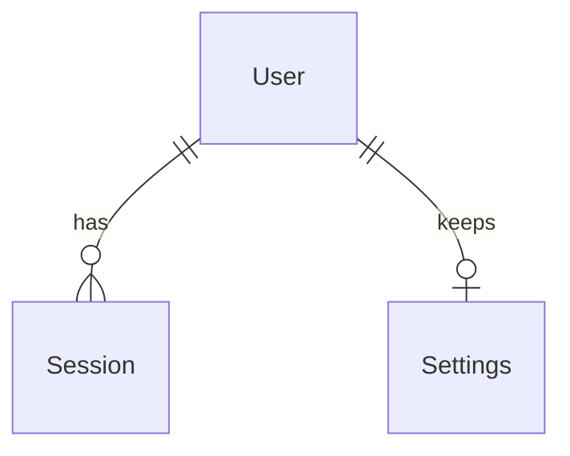

# Model schema — Archetype Web

## Entity-Relationship diagram

## Entities

| Entity | Attributes | Rules |
| --- | --- | --- |
| User | id, email, name, role, passwordHash, createdAt | Email is unique and lower case. Role is `user`. Name has 2 to 64 characters after trimming. Email has at most 64 characters. Password input has 8 to 64 characters. Only the salted password hash is stored. |
| Settings | userId, theme, dateFormat, updatedAt | Each user has at most one record. Theme is `system`, `light` or `dark`; dateFormat is `locale` or `iso`. A user with no record has the defaults `system` and `locale`. Only the current user reads or changes it. |
| Session | tokenHash, userId, createdAt, expiresAt | Each session belongs to one user. Only the token hash is stored. Expired sessions cannot authorize requests. Logout removes only the selected session. |

Public user data excludes passwordHash. Account data contains name, email and createdAt, and only the current user can read it. Timestamps use ISO 8601 in UTC.

---

> last updated: 2026-10-23T08:51:00Z
